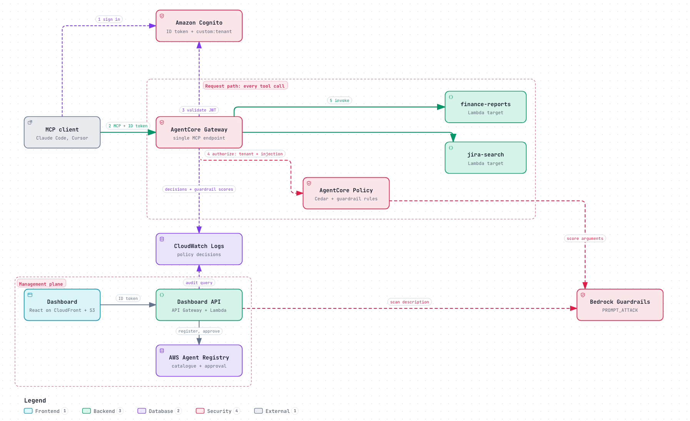

# Multi-tenant AI agent governance with Amazon Bedrock AgentCore

A reference implementation for giving AI agents controlled access to internal
systems, where several teams or tenants share one platform and each should only
reach what it is entitled to.

> **This is sample code for learning and demonstration. It is not production-ready.**
> It has not been hardened for production use, and the tools return canned data.
> Review it, deploy it to a non-production account first, and adapt it to your own
> security and compliance requirements before you use any part of it with real
> data or real users. You are responsible for the AWS charges the stack incurs.
> See [Before you use this in production](#before-you-use-this-in-production).

## Contents

- [Why this matters](#why-this-matters)
- [What this sample does](#what-this-sample-does)
- [Who this is for](#who-this-is-for)
- [Architecture](#architecture)
- [Prerequisites](#prerequisites)
- [Deployment](#deployment)
- [Connecting an MCP client](#connecting-an-mcp-client)
- [Testing](#testing)
- [Configuration](#configuration)
- [Cleanup](#cleanup)
- [Repository structure](#repository-structure)
- [Security](#security)
- [License](#license)

## Why this matters

AI coding assistants and agents become far more useful once they can reach
internal systems: reporting data, ticketing, internal APIs. The Model Context
Protocol (MCP) has made that easy, and in most organisations it is happening
bottom-up. A developer finds an MCP server, adds it to their assistant's config
file, and it works.

For the platform and security teams responsible for those internal systems, this
raises questions that are hard to answer:

- **What is connected?** There is no inventory of which tools exist or which
  agents are using them.
- **Who can use what?** Access usually follows whoever holds the credentials, not
  any policy the organisation has agreed.
- **Are tenants kept apart?** When several business units, subsidiaries, or
  customers share a platform, one tenant's agent must never reach another
  tenant's data. Enforcing that separately in every tool does not scale.
- **Is the input safe?** Agents pass text they did not write into tool calls.
  That makes tool arguments, and tool descriptions, a new route for prompt
  injection.
- **What happened?** When something goes wrong, there is often no record of which
  tool was called, by whom, and whether it should have been allowed.

Banning these tools rarely works. Developers find a way around the ban, and the
organisation loses what visibility it had. A better approach is to offer one
supported way in that is easier to use than the alternatives and is governed
centrally. This sample shows what that can look like.

## What this sample does

Every agent connects to a single MCP endpoint, and every request through it is
checked against the caller's identity and tenant before any tool runs.

| Concern | How the sample addresses it | Built with |
|---|---|---|
| One way in | A single MCP endpoint that any standard MCP client can use, with no plugin or extension | AgentCore Gateway |
| Knowing who is calling | Each request carries an Amazon Cognito ID token that includes the caller's tenant | AgentCore Gateway JWT authorizer, Amazon Cognito |
| Tenant isolation | Cedar policies decide which tools each tenant can see and call. Tools a tenant is not entitled to do not appear in its tool list at all | AgentCore Policy |
| Unsafe input | Tool arguments are scanned for prompt injection on every call, and new tool descriptions are scanned when they are registered | AgentCore Policy guardrail rules, Amazon Bedrock Guardrails |
| Inventory and ownership | A catalogue of every tool, its owner, and whether a reviewer has approved it | AWS Agent Registry |
| Audit | Every policy decision on a tool call is logged, and can be reviewed in the dashboard | Amazon CloudWatch Logs |

The sample includes two tenants, `finance` and `engineering`, each with one tool.
A finance user's assistant sees `finance-reports` and nothing else. An
engineering user's assistant sees `jira-search`. If either tries to call the
other tenant's tool, the request is refused.

A React dashboard puts the catalogue, the review queue, and the decision log in
one place. Tenants can propose new tools, and members of a reviewer group can
approve or reject them.

Tenants, tools, and enforcement settings are all defined in a single file,
[`governance.yaml`](governance.yaml). Adding a tool or a tenant means editing
that file and redeploying.

## Who this is for

- **Platform and security teams** planning how AI agents should reach internal
  systems, who want a working starting point rather than a design document.
- **Architects building multi-tenant platforms** who need agents from one tenant
  kept strictly apart from another's data.
- **Anyone evaluating Amazon Bedrock AgentCore** who wants to see Gateway,
  Policy, guardrails, and the registry working together in one deployable
  stack.

By working through the sample you will see how to:

- put a governed MCP endpoint in front of internal tools
- write Cedar policies that isolate tenants using a claim from the caller's token
- run a policy in log-only mode to see what it would block before you enforce it
- block prompt injection in tool calls with a guardrail rule in AgentCore Policy
- keep a reviewed catalogue of tools, and understand where it does and does not
  enforce anything

## Architecture



An interactive version, with search, zoom, and path tracing, is in
[`docs/architecture/architecture.html`](docs/architecture/architecture.html).
Download it and open it in a browser.

The top of the diagram is the request path that every tool call takes. The
bottom is the management plane used to register, review, and audit tools.
Bedrock Guardrails and CloudWatch Logs are shared by both.

The Gateway runs every step itself. It validates the caller's token, asks
AgentCore Policy for a decision, and only then invokes the tool Lambda, using its
own IAM role. The policy engine makes one decision per call that covers two
questions: may this tenant use this tool, and do the arguments look like a
prompt injection? For the second, it scores the arguments through Bedrock
Guardrails. It returns allow or deny to the Gateway; it never calls the tools.
The Gateway also delivers the policy decision logs, including guardrail scores,
to CloudWatch Logs.

What each step does to a request, in the order the Gateway runs them:

| Step | Condition | Result |
|---|---|---|
| 3. Validate token | Token missing, invalid, or expired | HTTP 401 |
| 4. Policy: tenant rule | Caller's tenant is not entitled to the tool | The tool does not appear in `tools/list`, and a direct `tools/call` is refused (JSON-RPC error `-32002`) |
| 4. Policy: guardrail rule | Arguments contain a prompt injection | The call is refused before the tool runs (JSON-RPC error `-32002`; the message names the tool's `prompt_injection_scan` rule) |
| 5. Invoke | All checks pass | The tool Lambda runs and returns its result |

Note that the registry is a catalogue, not an enforcement point. The Gateway does
not consult it when handling a request, so a record's approval status does not
affect whether a tool can be called. Access is controlled by the Cedar policies.
The dashboard displays this caveat alongside the catalogue.

## Prerequisites

- An AWS account and credentials configured for the AWS CLI
- A Region where Amazon Bedrock AgentCore is available. The sample is configured
  for `us-east-1`.
- Python 3.10 or later
- Node.js 18 or later
- AWS CDK v2 (`npm install -g aws-cdk`), with the account and Region bootstrapped
  (`cdk bootstrap`)
- An existing Amazon Cognito user pool with:
  - a custom attribute `custom:tenant`
  - an app client with `ALLOW_ADMIN_USER_PASSWORD_AUTH` and `ALLOW_USER_SRP_AUTH`
    enabled and no client secret
  - at least one user per tenant, with `custom:tenant` set to `finance` or
    `engineering`

The stack references the user pool rather than creating it, on the assumption that
most organisations already have an identity provider. All other resources are
created by the stack.

## Deployment

1. Clone the repository and install dependencies.

   ```bash
   git clone <repository-url>
   cd <repository-directory>

   python3 -m venv .venv
   .venv/bin/pip install -r requirements.txt
   ```

2. Edit `governance.yaml` and set the `cognito.user_pool_id` and
   `cognito.app_client_id` values to your own user pool and app client. Update the
   tool `owner` and tenant `admins` entries to match your users.

3. Build the dashboard. The CDK app uploads the built files from `dashboard/dist`,
   and synthesis fails if that directory does not exist.

   ```bash
   cd dashboard
   npm install
   npm run build
   cd ..
   ```

4. Build the SDK layer for the dashboard API. The Lambda Python runtime's
   built-in boto3 does not yet include the AWS Agent Registry client, so the
   dashboard API uses a layer with a newer, pinned boto3. Synthesis fails if the
   layer has not been built.

   ```bash
   .venv/bin/pip install \
     --requirement infra/dashboard/sdk_layer/requirements.txt \
     --target infra/dashboard/sdk_layer/build/python \
     --python-version 3.14 --only-binary :all: --no-compile
   ```

5. Deploy the stack.

   ```bash
   npx cdk deploy
   ```

   The stack outputs include the Gateway URL and the dashboard URL.

6. Create the reviewer group in your user pool and add the users who should be
   able to approve or reject tools. This is done outside CDK because reviewer
   membership is an organisational decision.

   ```bash
   aws cognito-idp create-group \
     --user-pool-id <user-pool-id> \
     --group-name platform-reviewers

   aws cognito-idp admin-add-user-to-group \
     --user-pool-id <user-pool-id> \
     --username <reviewer-username> \
     --group-name platform-reviewers
   ```

## Connecting an MCP client

The helper script signs in a user, exports the ID token as `AIGOV_TOKEN`, and
registers the Gateway with Claude Code. Source it so the variable is set in your
current shell.

```bash
source scripts/connect-claude-code.sh <username> '<password>'
claude mcp list
```

The script adds the server with a header that references the environment
variable, not the token itself:

```bash
claude mcp add --transport http aigov <gateway-url> \
  --header 'Authorization: Bearer ${AIGOV_TOKEN}'
```

This keeps the token out of `~/.claude.json`. Claude Code expands the variable
when it connects. Other MCP clients can be configured the same way using their own
settings for remote HTTP servers.

Use the ID token, not the access token. The `custom:tenant` claim is only present
on the ID token, and the Gateway rejects the access token with
`insufficient_scope`.

ID tokens expire after about an hour. Run the script again in a new shell to get a
fresh one.

## Testing

`scripts/verify.py` runs an end-to-end check against the deployed stack, signing
in as a user from each tenant.

```bash
.venv/bin/python scripts/verify.py --password '<password>'
```

It checks that:

- each tenant's `tools/list` contains its own tool and not the other tenant's
- a call to the other tenant's tool is refused
- a prompt injection in tool arguments is blocked
- registering a tool with a malicious description is refused and creates no
  registry record
- a user outside the reviewer group cannot approve a tool

The cross-tenant checks are the important ones. A policy set that allows
everything would pass a test that only checks each user can reach their own tool.

The checks register a test tool, and trying the dashboard changes approval
states. `scripts/reset-registry.py` puts the registry back to its starting state:
it returns each record declared in `governance.yaml` to its starting status, and
**deletes any record that is not declared there**, including tools registered
through the dashboard. Run it with `--dry-run` first to see what it would change,
or with `--keep-extras` to leave undeclared records in place.

```bash
.venv/bin/python scripts/reset-registry.py --dry-run
```

## Configuration

All tenants, tools, and enforcement settings are defined in
[`governance.yaml`](governance.yaml). The CDK app generates the Cedar policies,
Gateway targets, registry records, and Lambda functions from this file.

A tool definition looks like this:

```yaml
tools:
  - name: finance-reports
    tenant: finance
    owner: john@company.com
    handler: finance_reports      # infra/tools/finance_reports/handler.py
    description: >-
      Returns quarterly finance reports including revenue, operating
      expense and margin for a given quarter.
    arguments:
      quarter:
        type: string
        description: "Quarter to report on, e.g. q1 or q2"
        required: true
```

To add a tool, add an entry here and a matching handler under `infra/tools/`, then
redeploy.

Two settings control enforcement:

```yaml
governance:
  enforcement_mode: ENFORCE   # or LOG_ONLY

admission_scan:
  mode: ENFORCE               # or OBSERVE
  threshold: 0.4
```

- `enforcement_mode: LOG_ONLY` evaluates Cedar policies and records the decisions
  without blocking anything. Use it to see what a policy change would affect
  before enforcing it.
- `admission_scan.mode: OBSERVE` runs the guardrail rules in log-only mode. Each
  call's prompt-injection score is recorded in the decision log, with whether it
  would have changed the decision, and the call is allowed. Tenant isolation stays
  enforced.
- `admission_scan.threshold` is the score a call must exceed to be refused. Scores
  come in steps of 0.2, from 0 to 1. Run in `OBSERVE` mode first and read the
  scores before changing it.

If Bedrock Guardrails cannot be reached, calls to tools with a guardrail rule are
refused. There is no option to let them through.

## Cleanup

To avoid ongoing charges, delete the stack:

```bash
npx cdk destroy
```

The log groups, buckets, and other stateful resources are configured to be
removed with the stack. The Cognito user pool and the `platform-reviewers` group
were created outside the stack and are not deleted.

## Repository structure

```
governance.yaml                   tenants, tools, and enforcement settings
app.py                            CDK entry point

infra/config.py                   loads and validates governance.yaml
infra/gateway/stack.py            Gateway, policy engine, Cedar policies, targets
infra/gateway/observability.py    decision log delivery to CloudWatch
infra/guardrail/                  guardrail that scans tool descriptions at registration
infra/registry/                   AWS Agent Registry registry and tool records
infra/dashboard/                  dashboard hosting and API
infra/tools/                      tool Lambda handlers

dashboard/                        React dashboard (Vite)

scripts/connect-claude-code.sh    sign in and register the Gateway with Claude Code
scripts/verify.py                 end-to-end tests against the deployed stack
scripts/catalogue.py              list registry records and the review queue
scripts/decisions.py              query the policy decision log
scripts/reset-registry.py         restore registry records to their starting state

docs/architecture/                architecture diagram (PNG, interactive HTML, source JSON)
```

## Security

To report a potential security issue, see
[CONTRIBUTING](CONTRIBUTING.md#security-issue-notifications). Please do not create
a public GitHub issue.

### Before you use this in production

This sample does not include every control a production deployment needs. Before
you adapt it for real use, consider at least the following:

- **Dashboard API CORS.** The API allows requests from any origin
  (`allow_origins=["*"]`) because the CloudFront domain is not known until the
  distribution exists. Restrict it to your dashboard's origin, for example by using
  a custom domain.
- **CloudFront.** There is no AWS WAF web ACL and no custom domain, so the minimum
  TLS version cannot be raised above what the default `*.cloudfront.net`
  certificate allows.
- **Logging and encryption.** S3, CloudFront and API Gateway access logs are on and
  kept for 30 days. The CloudWatch log groups, including the policy decision log
  that serves as the audit trail, and the Lambda environment variables use default
  encryption. Consider customer managed KMS keys and a retention period that fits
  your audit requirements.
- **Lambda functions.** Each function this sample defines reserves 5 concurrent
  executions (`LAMBDA_RESERVED_CONCURRENCY` in `infra/config.py`). Lambda refuses a
  reservation that would leave fewer than 100 unreserved executions, so on an
  account with a low concurrency quota, lower or remove it. The functions are not
  in a VPC and have no dead-letter queue; every call to them is synchronous.
- **Who can change enforcement.** The enforcement mode (`ENFORCE` or `LOG_ONLY`) is a
  property of the Gateway, not of the Cedar policies. Anyone allowed to update the
  Gateway can change it, so restrict `bedrock-agentcore:UpdateGateway` and watch for
  changes.
- **Prompt-injection scan.** It raises the cost of an obvious attack but does not
  catch every injection: a quiet, documentation-shaped instruction passes. Guardrail
  scores are probabilistic. If Bedrock Guardrails cannot be reached, calls to the
  affected tools are refused. Keep a human reviewer in the loop for tool
  descriptions.
- **Identity.** The sample expects an existing Cognito user pool and uses example
  users. Replace them with your own identity provider and tenant claim.

## License

This sample is licensed under the MIT-0 License. See the [LICENSE](LICENSE) file.
